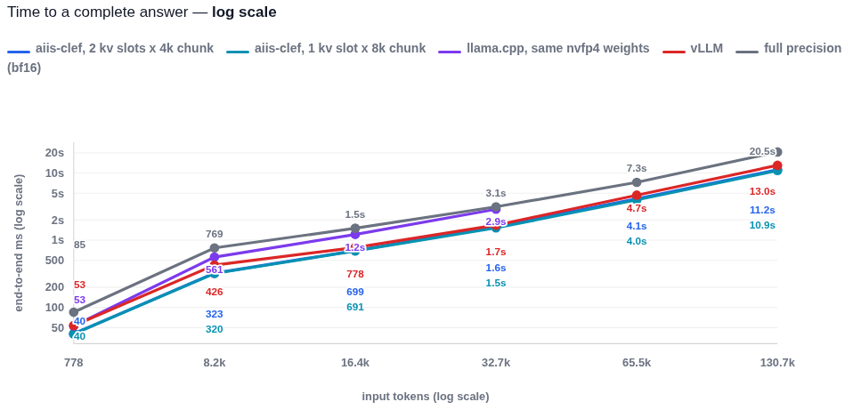
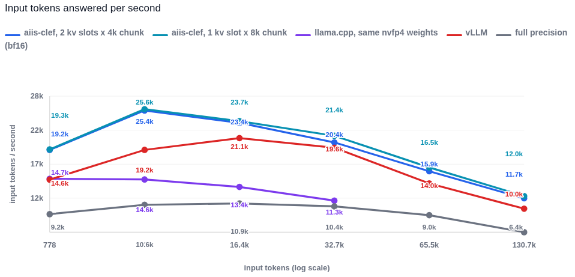
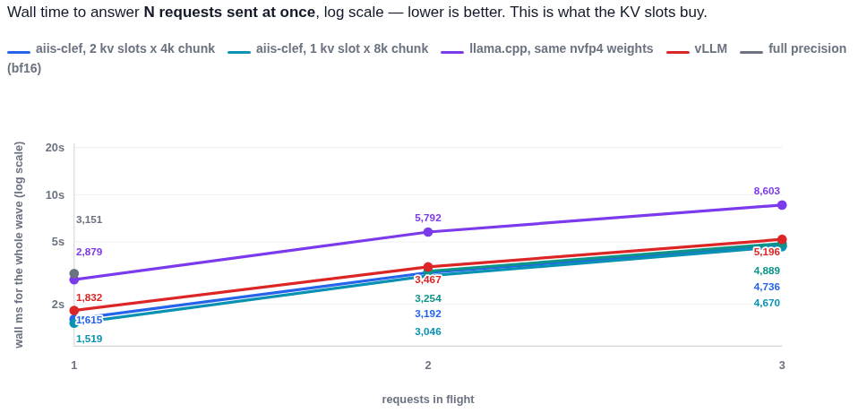
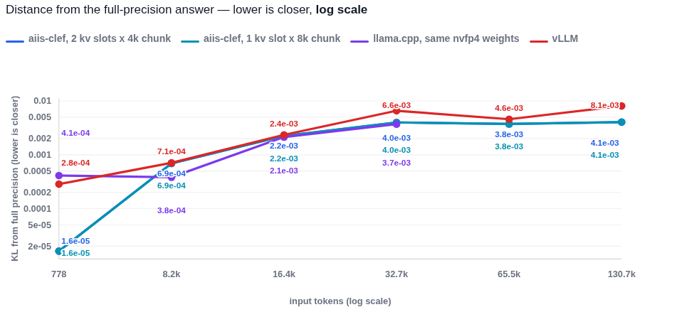
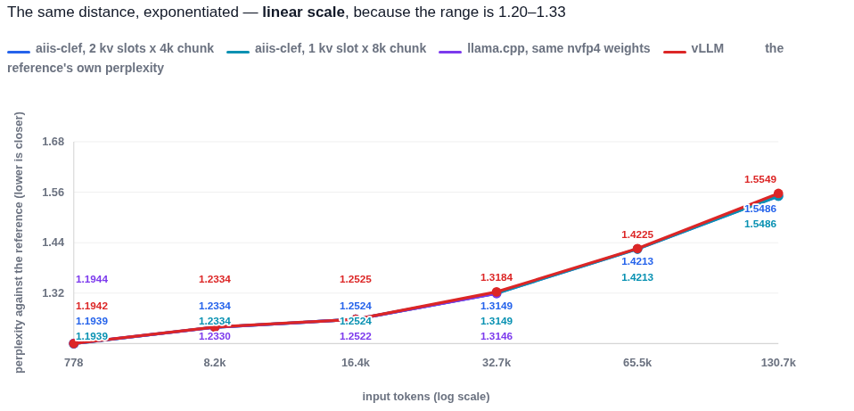

# aiis-clef — AI inference server for the Clef decision model

Hardware (RTX 5090) tuned fast Clef NVFP4 inference server. Outperforms vLLM with improved KL.

A single-binary, CUDA-native inference server for **Clef**, a hybrid Gated-DeltaNet / attention
decision model, served over the SystemOne contract (`POST /v1/systemone`). Rust for the host, our
own CUDA kernels for the math, no Python in the serving path.

The model answers typed questions about a `state` in **one forward pass** — it generates no tokens.
Every question is scored jointly, so a request is a prefill plus a small decision head.

## Headline: how it compares

One RTX 5090, one sitting, three rotated rounds per arm, every arm on the **same NVFP4 checkpoint**
except the full-precision reference. Median end-to-end latency, and the ratio against this server:

| input tokens | 778 | 8.2k | 16.4k | 32.7k | 65.5k | 130.7k |
| --- | --- | --- | --- | --- | --- | --- |
| **aiis-clef** | **40 ms** | **320** | **691** | **1,525** | **3,978** | **10,897** |
| vLLM | 53 | 426 | 778 | 1,672 | 4,692 | 13,025 |
| llama.cpp | 53 | 561 | 1,235 | 2,884 | — ¹ | — ¹ |
| full precision (bf16) | 85 | 769 | 1,510 | 3,145 | 7,262 | 20,544 |
| **vs vLLM** | **1.32×** | **1.33×** | **1.13×** | **1.10×** | **1.18×** | **1.20×** |
| **vs llama.cpp** | **1.31×** | **1.75×** | **1.77×** | **1.90×** | — | — |
| **vs bf16** | **2.10×** | **2.40×** | **2.18×** | **2.06×** | **1.83×** | **1.89×** |

**Accuracy**: mean KL against the full-precision answer is **1.6e-05 → 4.1e-03** from 778 to 130.7k
tokens, with **0 of 60 questions changing their top answer** at every size. The 4-bit weights are the
checkpoint's own NVFP4 tensors — nothing is re-quantised at load.

¹ llama.cpp's decision path evaluates a prompt in one physical batch, so its ubatch *is* its maximum
prompt; above ~32k the buffers do not fit on a 32 GB card. Its weights are the same NVFP4 tensors,
converted with the E4M3 scale bits preserved.

Full methodology, per-size charts, concurrency and the accuracy scatter: **[report/benchmark.html](report/benchmark.html)**.

## The charts

Every chart carries its own title and legend; the report they come from is [report/benchmark.html](report/benchmark.html).











## Requirements

| | |
| --- | --- |
| **GPU** | NVIDIA RTX 5090 (sm_120). The kernels are compiled for `sm_120` only — a different card needs `ARCH` in `build.rs` changed, and the tile shapes are tuned for this one |
| **Driver** | any driver that supports CUDA 13.0 (the build links `cuda-13030`) |
| **CUDA toolkit** | CUDA 13.x, for `nvcc` at **build** time only. The runtime uses the driver API through `cudarc`, so the toolkit is not needed on the serving host |
| **Rust** | 1.97+ (2021 edition) — `ntex` 4.6 sets that floor |
| **VRAM** | ~10 GB for the checkpoint plus the KV carry: **4,146 MiB** at a 131,072-token context, ~1.5 GB of graph pool. A 131k request peaks near **30 GB** |
| **Checkpoint** | a Clef NVFP4 directory (compressed-tensors `safetensors` + `joint_head_config.json` + tokenizer), pointed at by `CLEF_MODEL_DIR` |

## Build

```bash
cargo build --release          # needs nvcc on PATH; compiles the kernels to cubins and embeds them
./target/release/aiis-clef --help
```

`build.rs` finds `nvcc` (`$CUDARC_CUDA_VERSION`, `/usr/local/cuda/bin`, `PATH`), compiles each kernel
for `sm_120`, and fails the build if a `-D` it passes is discarded by the source — a silently ignored
define is how a kernel once shipped with the wrong tile.

## Run

```bash
export CLEF_MODEL_DIR=/models/clef-flash-nvfp4     # the checkpoint directory
export PORT=8000
./target/release/aiis-clef
```

Then:

```bash
curl -s localhost:8000/health
curl -s localhost:8000/v1/systemone -H 'content-type: application/json' -d '{
  "state": "User question: where does agent identity live?\nItems:\nitem 0:\nid: doc-0\ntitle: Note\ntext: ...",
  "questions": {
    "ans_0": {"type": "noul", "instructions": "Does the item answer the question?"}
  }
}'
```

The answer carries `probabilities` for `choice`/`score` questions and `noul` (P(true)) for `noul`.

## Configuration

None of these are required; the defaults are what the benchmark above measured.

| variable | default | what it does |
| --- | --- | --- |
| `CLEF_MODEL_DIR` | `/models/clef-flash-nvfp4` | checkpoint directory |
| `CLEF_HEAD_DIR` | `/models/clef-flash` | directory holding the joint head |
| `PORT` | `8000` | listen port |
| `CLEF_MAX_LENGTH` | the device's measured ceiling | longest request accepted; a request above it is refused with a 400 naming the numbers |
| `CLEF_KV_SLOTS` | `1` | requests in flight, i.e. the widest shared pass. A memory decision: a second slot does not fit the graph budget at the 8,192 chunk |
| `CLEF_MAX_CHUNK` | `8192` | the longest chunk one request contributes, and the top of the graph's geometry set |
| `CLEF_MAX_CONCURRENT` | `4` | how many requests the queue may coalesce |

## How it works, in one paragraph

A request is cut into rung-sized chunks (64 … 8,192 rows) and each pass runs the whole layer stack
once, replayed from a captured CUDA graph keyed on the pass geometry. Every per-request bound is a
**per-token map** (`cpos`, `cbase`, `seq_end`, `state_slot`), so a pass can carry several requests and
a request's answer does not depend on what it was batched with. Weights stay resident in their packed
NVFP4/FP8 form; the GEMMs read them directly. The three carries across a chunk boundary — the GDN's
recurrent state, the conv's history and attention's KV — are explicit buffers, which is what makes a
chunked request bit-identical to one pass.

## What is inside: the named techniques

Grouped by layer, with the canonical name and what it does here.

### Serving and scheduling

| technique | what we do |
| --- | --- |
| **Continuous batching** | every in-flight request's next chunk rides one pass; a pass carries up to `kv_slots` requests |
| **Chunked prefill** | a request is cut into rung-sized chunks (64 … 8,192 rows), each chunk a pass over the whole stack |
| **Pass fitting to a graphed geometry** | a shared pass's total must be in `pass_geometries()`; the chunks are water-filled to reach the nearest one — never padded, never eager |
| **Segmented KV cache** | one contiguous segment per in-flight request (`slot x capacity`); the mask's lower bound is the **segment base**, not the pass's first row |
| **CUDA Graphs, per pass geometry** | the whole layer stack is captured once per geometry and replayed; the key is the pass geometry, not the token count |
| **Dense warm-up ladder** | every geometry a pass can take is captured at load, so serving never captures cold |
| **On-idle graph capture** | a geometry the warm-up missed is captured on the engine thread's idle turn, never on the serving path |
| **Single retained allocation for all graphs** | one block sized by `max(high_water)`, not the sum of arenas — 768 MiB instead of 2.4 GB |
| **Graph memory pool** | the device pool is created and trimmed explicitly (`cuMemPoolCreate` / `cuMemPoolTrimTo`) |
| **Deferred long requests** | a 131k request cannot hold the queue; it is deferred while short requests drain |
| **Backpressure** | the listener resumes only when the queue can take work |
| **CPU affinity pinning** | the engine thread is pinned so the GPU launch thread does not migrate |
| **Zero-copy checkpoint** | safetensors are `mmap`ed and borrowed, never read into a second buffer |

### Attention

| technique | what we do |
| --- | --- |
| **Flash-Decoding (split-K over keys)** | long sequences split the key range across blocks and a combine kernel reduces the partials |
| **GQA / MQA** | 16 query heads over 4 KV heads; k/v are repeat-interleaved on device |
| **Varlen packed attention** | several requests in one launch with **per-token** bounds (`seq_start`, `seq_end`, `cpos`, `cbase`) — no per-request scalar |
| **Tensor-core attention** | `mma.sync` with fp16/bf16 fragments and a shared-memory staged pipeline |
| **Warp specialisation** | 8 MMA (consumer) warps + 4 producer warps, named barriers, `setmaxnreg` to move registers to the consumers |
| **Multi-stage SMEM pipeline** | `cp.async` producer → `mbarrier` → MMA consumer |
| **Partial rotary + mRoPE** | rotary on 25% of the head dims, interleaved mRoPE sections, tables built once on device |
| **Fused QK-norm + RoPE + q/gate split** | three ops in one kernel, bit-exact against the chain |
| **Sink path** | the head reads a per-request accumulated hidden buffer instead of a second pass driver |

### Linear attention (Gated DeltaNet)

| technique | what we do |
| --- | --- |
| **Chunked gated delta rule** | the recurrence is evaluated a 64-row chunk at a time with a WY-style chunk formulation (W/U products), which is what makes chunked prefill possible for a linear-attention model |
| **Sequential scan with per-slot state** | the state carry is explicit; the chunk-parallel scan was measured and refuted (2x work for at most 25% makespan) |
| **State carry across chunk boundaries** | each request's recurrent state lives in its own slot; a pass boundary is a state save/restore |
| **Fused conv + SiLU + history save** | causal conv, activation and the conv history write in one kernel |
| **Tap-window conv prep** | `gdn_conv_prep` reads only the window its taps need — 683.6 → 559.6 us, 11x fewer L1 sectors |
| **Fused gated RMSNorm + quantiser** | norm and the NVFP4/FP8 quantiser in one pass: 555 → 287 MB per layer-pass |

### GEMM and quantisation

| technique | what we do |
| --- | --- |
| **NVFP4 block-scaled W4A4 MMA** | Blackwell `mma.sync.aligned.kind` with E2M1 weights and E4M3 scales per 16 values — the checkpoint's own tensors, read directly |
| **Swizzled scale layout** | the reference's 128x4 swizzle computed once at load, not per launch |
| **TMA (tensor memory accelerator)** | `cp.async.bulk.tensor` for A, B and the epilogue store, with `mbarrier` transaction counts |
| **Multi-stage software pipeline** | `STAGES 3` double/triple buffering in shared memory |
| **Warp specialisation + `setmaxnreg`** | a producer warpgroup feeds, consumer warpgroups MMA; registers are moved to the consumers at runtime |
| **Persistent CTA scheduler** | `grid = min(work_tiles, SMs x CTAs/SM)`, each CTA walks a strided tile set |
| **Epilogue in its own SMEM** | `EPI_SEPARATE` so a persistent CTA can start tile N+1 before tile N's store is read |
| **Fused gated GEMM** | the MLP's `gate` and `up` in one launch, `silu(g) * u` written straight out as quantised NVFP4 |
| **FP8 E4M3 GEMM with per-token scales** | row-wise activation scales, two MMA atoms (fast / half-rate) shipped together |
| **bf16 GEMM with split-K** | key-split for small `m`, partials reduced in a second kernel |
| **On-the-fly activation quantisation** | the quantiser is fused into the producer, not a separate pass |
| **Dual-output norm** | `rms_norm` → FP8 **and** bf16 in one pass (3.0x on the kernel) |

### The decision head

| technique | what we do |
| --- | --- |
| **Single-pass joint decision head** | every question is answered from one forward pass; no token generation |
| **Gathered `lm_head` rows** | only the option tokens' rows of the 248k x 4096 head are gathered, not the whole matrix |
| **Its own graph ladder** | the head has a rung ladder of its own (48 graphs), captured separately from the body |

### Correctness and measurement method

| technique | what we do |
| --- | --- |
| **Bit-exactness gates** | every fusion is gated against the unfused chain it replaces, at two sizes, asserting **exact** equality |
| **Determinism gate ("same call twice")** | two identical calls must produce identical bytes — this is what caught a rounding change and a two-writer scale race |
| **KL against a bf16 oracle** | the accuracy invariant, checked at three token counts |
| **Ablation cubins** | the same kernel compiled with a piece removed, so "how much is the epilogue" is a subtraction |
| **A/B in one binary** | both variants ship as cubins and an environment switch selects one, so a comparison is one window and one binary |
| **Tile / occupancy model** | `tiles = ceil(m/M) x ceil(n/N)`, waves, makespan, fitted from measurements — used to reject tiles without building them |
| **Roofline and counter checks** | `ncu` for tensor-pipe and DRAM utilisation, `cuobjdump -res-usage` for registers and spills |
| **Paired rounds, rotated ladder** | three rotated rounds, medians, a settle between arms, and a paired A/B for anything under the cross-window drift |

## Attribution

The kernels and the engine were written for this project. The tiling, the NVFP4 block-scaled MMA
layout and the Gated-DeltaNet formulation follow the published work of the reference implementations
surveyed in the parent research tree (candle, llama.cpp, vLLM, TensorRT-LLM and the Qwen technical
reports). `cudarc` is the CUDA driver binding; `tokenizers` and `safetensors` are Hugging Face crates.

## License

Apache License 2.0 — see [LICENSE](LICENSE).
